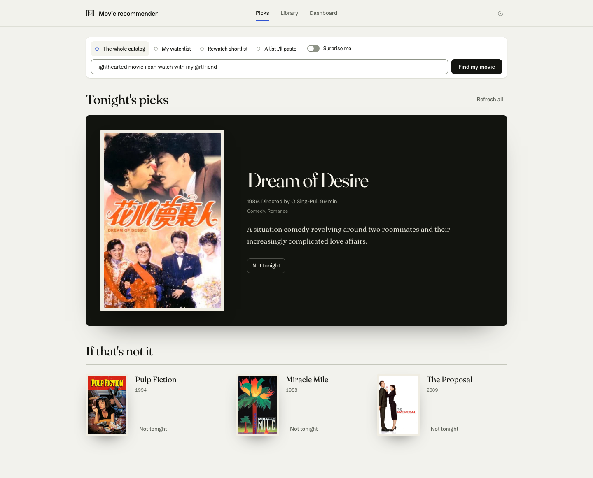
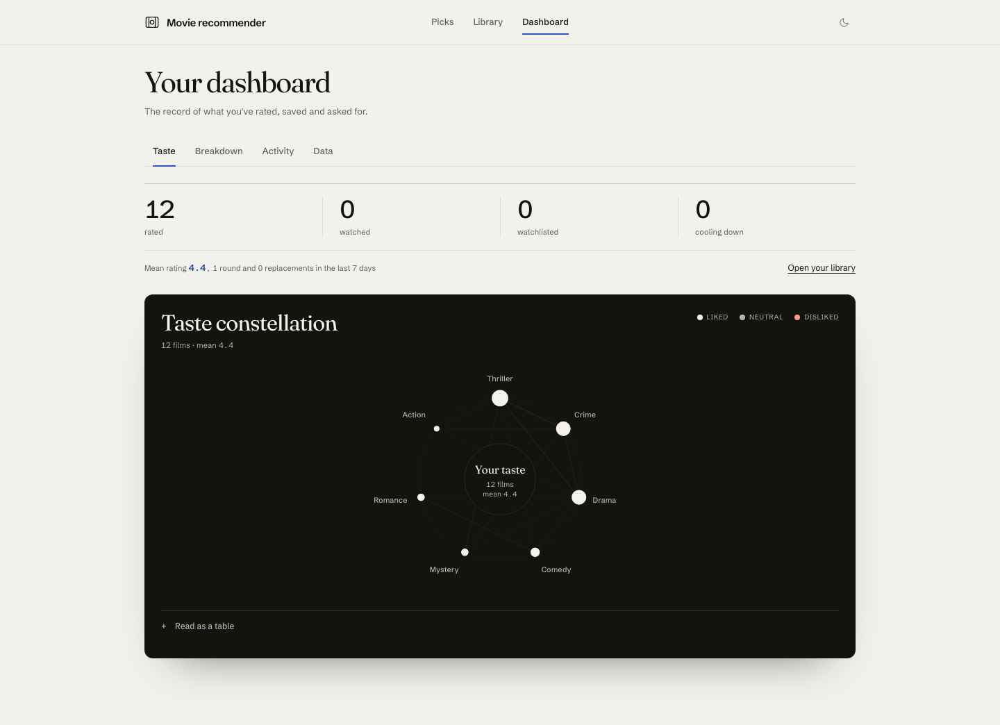
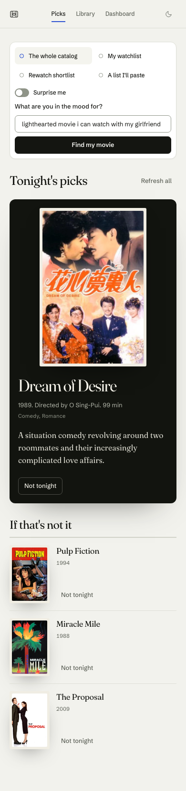
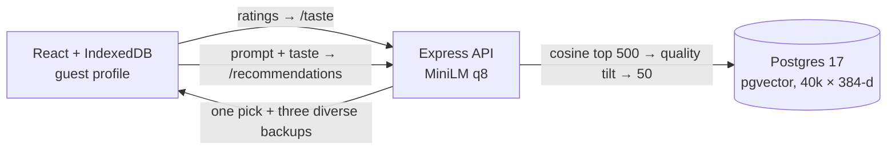

# Movie recommender

**One good pick, three varied backups — no endless scrolling.**

A guest-first movie recommender over a 40,000-film catalog. It turns your ratings
into a taste vector, searches by embedding similarity, applies a measured
reception tilt, reranks for variety, and keeps everything personal in the browser.



## Why

Choosing a film is a decision problem disguised as a browsing problem. Infinite
grids make it worse: more options, more scrolling, later decisions. This project
takes the opposite position — one confident pick, three backups, and a prompt if
you want to say what kind of night it is. No account, no onboarding, no feed.

## What it does

- **One pick + three alternatives.** Replace one without disturbing the others,
  or refresh all. Replaced films cool down for seven days instead of being
  treated as disliked.
- **Natural-language briefs.** Genres, decades and runtime ranges become hard
  filters; mood phrases add a small, measured genre affinity at ranking time.
- **Guest-first.** Ratings, watchlist, watched state, cooldowns and history live
  in IndexedDB. Export a Letterboxd-compatible CSV or a JSON backup, or delete
  everything in one step.
- **Library and dashboard.** Rate in half-stars, import a Letterboxd export, and
  see a taste constellation, genre-affinity bars, rating spread and recent picks.

## See it

| Taste constellation | Mobile |
| --- | --- |
|  |  |

There is no hosted demo. The catalogue is TMDB-derived and the terms do not
allow a public launch without licensing; the screenshots above are real, taken
from the running app.

## How it works



1. **Taste.** Ratings are weighted by `rating − 2.5`, summed and normalized into
   a 384-d unit vector. The API is stateless; the vector is transient.
2. **Prompt.** The prompt is embedded with the same pinned MiniLM revision and
   combined with taste at equal weights. Recognized genre, decade and runtime
   phrases become hard SQL filters; supported mood phrases add a small
   genre-affinity term at ranking time.
3. **Retrieve.** pgvector returns the top 500 films by cosine similarity after
   the hard filters.
4. **Tilt.** The buffer is reordered by `similarity + 0.50 × reception` and cut
   to 50. Reception is 70% vote average and 30% log-scaled vote count.
5. **Rerank.** A greedy diversity pass with a 0.30 similarity penalty selects
   one main pick and three alternatives.

## Results

Held-out evaluation: a rating ≥ 4 is relevant; Recall@4 and NDCG@4 use the top
four; MRR scans the full returned ranking. Production uses the top-500 buffer,
the 0.50 pool tilt, a 50-film pool and the diversity rerank.

| Config | Recall@4 | NDCG@4 | MRR |
| --- | --- | --- | --- |
| Production | 0.0078 | 0.0195 | 0.0570 |
| Popularity baseline | 0.0082 | 0.0195 | 0.0579 |
| Genre baseline | 0.0046 | 0.0132 | 0.0374 |

The honest read: production **matches popularity on NDCG@4 and beats the genre
baseline on every metric**, but still trails popularity slightly on Recall@4 and
MRR. The pool-stage tilt is the measurable win — it lifted the production pool
from 0.0064 / 0.0156 / 0.0385 to 0.0078 / 0.0195 / 0.0570.

Prompt evaluation uses a 35-case labelled set across explicit, soft, edge and
control prompts:

- **35/35** parse accuracy and **16/16** filtered cases satisfying every hard
  constraint, with zero empty result sets across the weight sweep.
- The mood boost is **0.18**, chosen by a pre-declared tune/hold-out rule. The
  production prompt/taste weights remain **0.50 / 0.50**; a `0.80 / 0.20`
  candidate is recorded but deferred because it collapses taste similarity.
- Reports: [`docs/evaluation-experiments-2026-11-24-round2.md`](docs/evaluation-experiments-2026-11-24-round2.md)
  and [`docs/evaluation-prompt-2026-11-26.md`](docs/evaluation-prompt-2026-11-26.md).

Tests: **378 web** tests and **601 API** tests with a local database
(143 database tests skip without `DATABASE_URL`).

## Decisions worth challenging

- **Guest-first, no accounts.** The profile is the browser. It costs cross-device
  sync and makes clearing storage destructive; export/import is the escape hatch.
- **A 0.50 reception tilt.** It beats the genre baseline on held-out metrics and
  matches popularity on NDCG, but it means well-received films can outrank a
  closer taste match within the pool. The weight is documented and retunable.
- **500 → 50 → diversity.** The pool-stage tilt and the 500-film buffer were the
  round-2 winners; the 50-film pool is a deliberate latency/quality trade.
- **Seven-day cooldowns.** Replacement is a “not tonight”, not a dislike. The
  cooldown prevents the same film from bouncing back immediately.
- **A mood boost instead of more prompt weight.** The sentence embedding cannot
  separate “lighthearted” from “movie”, even at 100% prompt weight. A small,
  bounded genre affinity fixed the reported case without discarding taste.
- **Half-star ratings as a ten-step segmented control.** The old star overlay had
  ~9.6 px half-targets; the replacement gives 44 px targets on coarse pointers
  while keeping native radio semantics.

## Limits

- **Catalogue rights.** The TMDB-derived catalogue is for personal,
  non-commercial use; a public launch needs licensing or a different catalogue.
  There is therefore no hosted demo.
- **Prompt understanding is shallow.** Hard filters are rules; mood is a phrase
  table plus a small ranking term, not a language model. The embedding gap is
  measurable.
- **Embedding batch parity is unresolved.** Catalogue vectors were generated in
  batches, queries singly; under the q8 model that changes ~15% of top-10
  results. Re-embedding is deferred.
- **The taste graph resolves every rated film individually.** It is fine for a
  normal library, slower at the 500-rating cap.
- **No CI, hosting or maintenance.** This is a finished portfolio project, not a
  service. No accounts, no PWA, no server-side profile.

## Run it locally

Requirements: Node.js ≥ 24, Docker with Compose, and about 1.5 GB of free disk
(the TMDB snapshot CSV, the MiniLM model and the imported catalogue).

```sh
npm install
cp .env.example .env
npm run db:up
npm run db:migrate
```

Download the Kaggle
[`alanvourch/tmdb-movies-daily-updates`](https://www.kaggle.com/datasets/alanvourch/tmdb-movies-daily-updates)
snapshot (`TMDB_all_movies.csv`) and import it once:

```sh
SNAPSHOT_CSV=/path/to/TMDB_all_movies.csv npm run catalog:import-snapshot
```

The first import downloads the pinned `all-MiniLM-L6-v2` int8 model (~25 MB),
curates the top 40,000 films by popularity, and embeds them. Expect roughly
25 minutes on CPU. The import is idempotent and verifies counts, unique ids and
embedding dimensions after insert.

Then run the app:

```sh
npm run dev:api   # http://localhost:3000
npm run dev:web   # http://localhost:5173
```

```sh
curl -s http://localhost:3000/health
# {"status":"ok"}
```

## Commands

Run these from the repository root.

| Command | What it does |
| --- | --- |
| `npm run dev:api` | API with watch mode on port 3000 |
| `npm run dev:web` | Vite dev server on port 5173 |
| `npm run build` | Production build (web only; API/shared have no build step) |
| `npm run typecheck` | TypeScript across all workspaces |
| `npm run lint` | ESLint |
| `npm run format` / `format:check` | Prettier write / check |
| `npm test` | All workspace tests |
| `npm run db:up` / `db:down` | Start / stop PostgreSQL |
| `npm run db:migrate` | Apply Drizzle migrations |
| `SNAPSHOT_CSV=… npm run catalog:import-snapshot` | Import or refresh the catalog (fixed 40,000 rows) |
| `npm run evaluate:ranking` | Held-out ranking evaluation (needs MovieLens CSVs, see below) |
| `npm run evaluate:experiments` | Ranking experiment sweep on the same split |
| `npm run evaluate:prompt` | Offline labelled prompt/parser evaluation |

Database tests skip unless `DATABASE_URL` is set. To run the whole suite against
the real database:

```sh
set -a; . ./.env; set +a
npm test
```

### Evaluation inputs

The ranking harness needs MovieLens `ratings_small.csv` and `links.csv` from
Kaggle's [`rounakbanik/the-movies-dataset`](https://www.kaggle.com/datasets/rounakbanik/the-movies-dataset)
and a populated catalog:

```sh
MOVIELENS_RATINGS_CSV=/path/ratings_small.csv \
MOVIELENS_LINKS_CSV=/path/links.csv \
npm run evaluate:ranking -w @movie-recommender/api -- --output ../../docs/evaluation-rundate.md
```

Always pass `--output`; the default path overwrites the 2026-11-23 report. Both
harnesses are offline, deterministic and never change served code or weights.

## API

Base URL: `http://localhost:3000`. JSON only. Every error uses the same envelope;
`details` is optional and its shape depends on the code (Zod issues for
`invalid_request`, `{ "movieIds": [...] }` for `unknown_movie_ids`):

```json
{ "error": { "code": "invalid_request", "message": "…", "details": [] } }
```

| Method | Path | Purpose |
| --- | --- | --- |
| `GET` | `/health` | Liveness check |
| `GET` | `/movies/search?q=alien` | Case-insensitive title search (2–80 chars, 20 results) |
| `GET` | `/movies/:id` | One movie card |
| `POST` | `/taste` | Ratings → normalized taste vector, or `null` |
| `POST` | `/imports/letterboxd` | Match a Letterboxd ratings/watches/watchlist CSV to catalog ids |
| `POST` | `/recommendations` | Up to four ranked movies plus a cold-start flag |

`GET /movies/search` responds with `{ "movies": [ …cards… ] }`.
`GET /movies/:id` responds with `{ "movie": { …card… } }`. Both use the card
shape below.

### Movie card

```json
{
  "id": 862,
  "title": "Toy Story",
  "releaseYear": 1995,
  "runtime": 81,
  "overview": "Led by Woody, Andy's toys…",
  "genres": ["Animation", "Comedy", "Family"],
  "director": "John Lasseter",
  "cast": ["Tom Hanks", "Tim Allen", "…"],
  "posterPath": "/rhIRbceoE9lR4veEXuwCC2wARtG.jpg",
  "voteAverage": 7.7
}
```

`posterPath` is a TMDB path, never a full URL. Use it with the TMDB image base
(`https://image.tmdb.org/t/p/w500`) subject to TMDB's terms.

`releaseYear`, `runtime`, `overview`, `director`, `posterPath` and `voteAverage`
are nullable; the catalog has films with missing metadata.

### Taste

```sh
curl -s -X POST http://localhost:3000/taste \
  -H 'content-type: application/json' \
  -d '{"ratings":[{"movieId":862,"rating":5},{"movieId":8844,"rating":1.5}]}'
```

- 1–500 unique ratings, 0.5–5 in half-star steps.
- Returns `{ "tasteVector": [ … 384 numbers … ] }` or `{ "tasteVector": null }`
  when the ratings cancel out or all sit at the 2.5 baseline.
- Unknown or unembedded movie ids return `400 unknown_movie_ids`.
- Stateless: nothing is stored or logged.

### Recommendations

```sh
curl -s -X POST http://localhost:3000/recommendations \
  -H 'content-type: application/json' \
  -d '{"source":"catalog","prompt":"a 90s sci-fi under two hours","limit":4}'
```

```json
{ "movies": [ { "id": 862, "title": "Toy Story", "…": "…" } ], "coldStart": true }
```

- `source`: required; `catalog`, `watchlist` or `list`.
- `catalog` must omit `candidateIds`; `watchlist`/`list` require a non-empty
  `candidateIds` array (the client's local list).
- `candidateIds` and `excludeIds`: at most 10,000 unique ids each.
- `tasteVector`: optional 384-d vector, finite, `|value| ≤ 10`. Omit or send
  `null` for cold start.
- `prompt`: optional natural-language direction, trimmed to 1–300 characters.
  It is embedded with the pinned model and combined with `tasteVector` at equal
  weights; recognized genre, decade and runtime phrases become hard filters, and
  supported mood phrases add a small genre-affinity term at ranking time.
- `excludeIds`: optional watched/cooldown ids.
- `limit`: required, 1–4.
- Bodies over 256 kB return `413 payload_too_large`; bursts beyond 30 requests
  per minute per IP return `429 rate_limited`.
- Popularity and vote counts are never eligibility gates. They do steer ranking:
  the retrieval pool (top 500 by cosine, trimmed to 50) and the diversity rerank
  both add `0.50 ×` a log-scaled reception score.

## Guest profile

Everything the guest owns lives in IndexedDB in the browser: half-star ratings,
watched films, watchlist, seven-day replacement cooldowns and recommendation
history. There is no account and no server-side profile.

- **Library** — search the catalogue, rate half-stars, toggle watched and
  watchlist, and import a Letterboxd CSV (matched/unmatched report; unmatched
  films are not invented).
- **Dashboard** (`#dashboard`) — hash-routed `Taste`, `Breakdown`, `Activity` and
  `Data` tabs. Taste holds the counts, mean, round/replacement line and the genre
  constellation; Breakdown holds the rating spread and all-genre affinity bars;
  Activity holds recent picks; Data holds export, backup and delete.
- **Your data** — export ratings as a Letterboxd-compatible CSV (the URI column
  stays empty; we never store Letterboxd URIs), export a versioned JSON backup,
  or delete every local row at once.

The API only ever receives transient per-request inputs — the taste ratings,
recommendation id arrays/vectors, and catalogue lookups by movie id — and none
are logged or persisted. Ratings reach `POST /taste`; history, imports and
exports stay entirely local.

## Project layout

```
apps/api/src/
  app.ts                 Express app and error handling
  server.ts              Bootstrap
  db/                    Drizzle schema, client, migration tests
  modules/movies/        Snapshot import, parsing, search/detail routes
  modules/taste/         Pure taste-vector math + /taste route
  modules/recommendations/ Candidate query, constraints, pool tilt, diversity rerank, route
  modules/imports/       Letterboxd CSV matching
  evaluation/            Offline ranking and prompt harnesses
apps/web/src/
  App.tsx                Recommendation screen, hash navigation
  Library.tsx            Search, ratings, watched and watchlist toggles
  Dashboard.tsx          Tabbed stats, taste graph, history, export and delete
  TasteConstellation.tsx SVG genre graph, table fallback
  GenreAffinity.tsx      Diverging genre bars
  tasteGraph.ts          Pure genre counts, affinity and co-occurrence math
  profile/               Dexie-backed guest profile (validate-on-read)
packages/shared/         Zod request/response contracts
db/init/                 pgvector extension for Compose
docs/seed-inspection.md  2017 seed inspection (historical record)
docs/catalog-snapshot-2026.md  Current catalog provenance and curation
docs/evaluation-*.md     Held-out ranking and prompt reports
docs/images/             Screenshots used above
```

## Data and license

The catalogue is imported from alanvourch's Kaggle *TMDB daily updates* export
(2026-11-21 snapshot), curated to the top 40,000 movies by popularity among
Released films with an overview and a positive runtime; see
[`docs/catalog-snapshot-2026.md`](docs/catalog-snapshot-2026.md) for verified
counts, provenance and the curation rule. The original 2017 MovieLens-linked
seed inspection is preserved in
[`docs/seed-inspection.md`](docs/seed-inspection.md).

Kaggle labels the exports (CC0 / Apache-2.0), but the content comes from TMDB
and GroupLens and cannot be relicensed:

- TMDB terms forbid caching beyond six months, dataset collection for ML, and
  commercial use without an agreement; attribution is required.
- GroupLens ratings are licensed for research use only.

Treat this project as a **personal, non-commercial MVP**. A public or commercial
launch needs TMDB licensing and GroupLens permission, or a different catalogue.

The MovieLens ratings are not imported into the application database. They are
kept for offline evaluation only.

## What I'd do next

Nothing is promised: this is a finished portfolio project, not a maintained
service. If it were continued, the two technical follow-ups are:

- resolve the embedding batch-parity question and re-evaluate prompt/taste
  weights on the corrected vectors;
- a batch catalogue lookup for the taste graph at large libraries.

Deliberately not planned: CI, public hosting, a one-command self-host bundle,
accounts, PWA, catalogue growth, or further ranking tuning without new held-out
evidence.

## More docs

- [`PRODUCT.md`](PRODUCT.md) — what the product must do
- [`ARCHITECTURE.md`](ARCHITECTURE.md) — approved technical decisions
- [`BACKLOG.md`](BACKLOG.md) — implementation order and status
- [`AGENTS.md`](AGENTS.md) — workflow for coding agents
- [`docs/evaluation-explained-2026-11-24.md`](docs/evaluation-explained-2026-11-24.md) — why the tilt exists, in plain language
- [`docs/evaluation-experiments-2026-11-24-round2.md`](docs/evaluation-experiments-2026-11-24-round2.md) — round 2: pool-stage tilt won, fusion and z-scoring lost
- [`docs/evaluation-prompt-2026-11-26.md`](docs/evaluation-prompt-2026-11-26.md) — labelled prompt set, parser audit and mood sweep
- [`docs/letterboxd-integration.md`](docs/letterboxd-integration.md) — CSV import behaviour and limits
- [`docs/catalog-snapshot-2026.md`](docs/catalog-snapshot-2026.md) — catalogue provenance and curation
